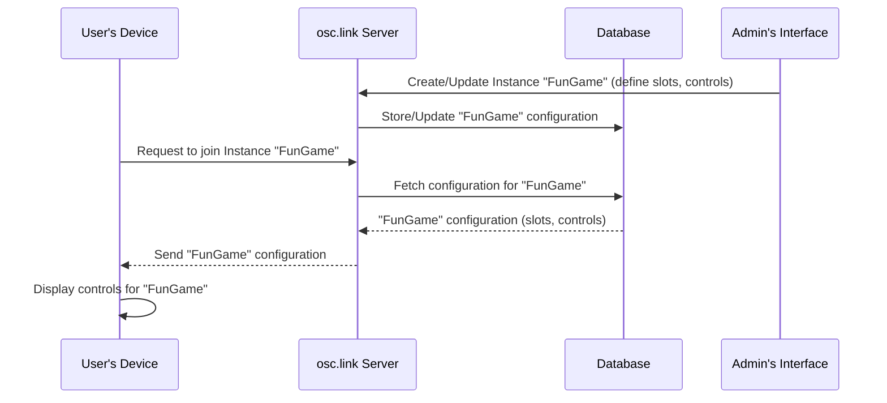

# Chapter 1: Instance (Session Configuration)

Welcome to the `osc.link` tutorial! We're excited to help you understand how `osc.link` enables new forms of interactive experiences. Let's start with the very first concept you'll encounter: the **Instance**.

## What's the Big Idea? The "Room" for Your Event

Imagine you want to host an interactive show. Maybe it's a musical performance where audience members can use their phones to trigger sounds, or a live drawing session where people can collaboratively paint on a digital canvas.

How do you set up a specific "event" or "room" for this? How do you define:
*   How many people can join?
*   What will they see on their screens?
*   What buttons or sliders will they have?

This is exactly what an **Instance (Session Configuration)** in `osc.link` solves!

Think of an Instance as a **unique, configurable "room" or "event" that users can join.** Each Instance has its own set of rules and tools, creating a tailored interactive experience.

## Anatomy of an Instance: What Makes Up a "Room"?

An Instance is essentially a collection of settings that define a specific `osc.link` session. Let's look at the key ingredients:

1.  **ID (Identifier):**
    *   Every Instance has a unique ID (like a room number, e.g., "7", "alpha-bravo-charlie").
    *   This ID is how users join a specific session, often through a URL (`https://osc.link/instance/YOUR_ID`) or a QR code.

2.  **Name & Description:**
    *   A friendly name (e.g., "Interactive Light Show," "Audience DJ Booth") and a description to tell people what the session is about.

3.  **Slots (User Capacity):**
    *   This setting determines the **maximum number of users** that can participate in the Instance at the same time.
    *   Analogy: The number of chairs available in your interactive room.

4.  **Slot Assignment Rules:**
    *   How are users assigned to these available "slots" or "chairs"?
        *   **Sequential Pick (`sequentialPick`):** Users are assigned slots in the order they join (first come, first served).
        *   **Random Pick (`randomPick`):** Users are assigned a random available slot.
        *   **Slot Pick (`slotPick`):** Users can choose a specific slot number if it's available.

5.  **Controls (Interactive Elements):**
    *   This is the exciting part! It defines the **set of interactive elements** (like buttons, XY pads, text input fields, sliders) that participants will see and use on their devices.
    *   For example, one Instance might have a single "Launch Firework" button, while another might have an XY pad for drawing and several color-picker buttons.
    *   We'll dive deep into [Controls (User Input Elements)](02_controls__user_input_elements__.md) in the next chapter!

**Who creates these Instances?** Typically, an **admin** (like you, the event organizer or developer) configures these Instances through an interface, tailoring the experience for the participants.

## A Peek at an Instance Configuration

Instances are often defined using a structured format like JSON. Let's look at a simplified example based on what `osc.link` uses. Don't worry if it looks a bit technical; we'll break it down.

```json
// Simplified from: packages/web/src/dummy/instances.ts
{
  "id": "1",
  "name": "Default Fun Session",
  "description": "A simple session with a few buttons.",
  "settings": {
    "slots": 4,
    "sequentialPick": true,
    "slotPick": false,
    "randomPick": false,
    "controls": {
      "buttons": [
        { "id": "b1", "type": "button", "options": { "label": "Press Me!" } }
      ]
    }
  }
}
```

Let's break this down:
*   `"id": "1"`: This session's unique identifier is "1".
*   `"name": "Default Fun Session"`: A friendly name for this session.
*   `"settings"`: This object holds all the specific rules for this session.
    *   `"slots": 4`: This session can have a maximum of 4 participants.
    *   `"sequentialPick": true`: Participants will be assigned slots 1, 2, 3, then 4 as they join.
    *   `"controls"`: Defines what users can interact with.
        *   `"buttons": [...]`: This session has one button.
            *   `{ "id": "b1", "type": "button", "options": { "label": "Press Me!" } }`: This defines a button with the ID "b1" that displays the text "Press Me!".

This configuration tells `osc.link` exactly how to set up the "Default Fun Session." When a user joins Instance "1", they'll be one of up to four users and will see a "Press Me!" button on their screen.

## How Instances Come to Life: Creation and Joining

Let's briefly look at the lifecycle of an Instance:

**1. Admin Creates an Instance:**
*   An administrator uses a tool (perhaps a web interface like the `InstanceEditor` component seen in `packages/web/src/components/InstanceEditor/InstanceEditor.tsx`) to define all the settings we discussed (name, slots, controls, etc.).
*   This configuration is then saved on the `osc.link` server. The server uses code like in `packages/server/src/routes/instances.ts` to handle these requests and stores the Instance details, often in a database (as defined by `packages/server/src/models/Instance.ts`).

```javascript
// Conceptual: Admin saving an instance (simplified)
// This would happen on a server, responding to an admin's request.
async function createInstance(name, settings) {
  // 1. Generate a unique ID for the instance
  const instanceId = generateUniqueId();
  // 2. Store the instance configuration in a database
  await database.saveInstance(instanceId, name, settings);
  // 3. The instance is now ready for users to join!
  return instanceId;
}
```
This code snippet gives a high-level idea: the server takes the name and settings, assigns an ID, and stores it.

**2. User Joins an Instance:**
*   Users receive a unique link (e.g., `https://osc.link/join/1`) or scan a QR code corresponding to an Instance ID.
*   Their device (phone, tablet, computer) connects to the `osc.link` server.
*   The server looks up the configuration for the requested Instance ID.
*   The user's screen is then populated with the specific controls (buttons, sliders, etc.) defined in that Instance's configuration.

## Under the Hood: A Quick Tour

When you join an Instance, or an admin wants to see the list of available Instances, a few things happen behind the scenes:

1.  **Request:** Your device (the client, which could be your web browser or the [Electron Host Application (OSC Bridge)](04_electron_host_application__osc_bridge__.md)) sends a request to the `osc.link` server asking for information about a specific Instance or a list of all available Instances.
2.  **Server Processing:**
    *   The server (using code like in `packages/server/src/routes/instances.ts`) receives this request.
    *   It fetches the Instance configuration from its database (where `packages/server/src/models/Instance.ts` defines how Instance data is structured).
    *   For live sessions, the server also keeps track of active users and their states in memory (as seen in `packages/server/src/inMemoryInstances.ts`).
3.  **Response:** The server sends the Instance configuration (or list of Instances) back to your device.
4.  **Display:** Your device then uses this information to display the correct interface (e.g., the buttons and XY pads for that session).

Here's a simplified visual of a user joining an Instance:


This diagram shows the admin setting up an Instance first, and then a user joining it. The server and database are central to storing and retrieving the Instance details.

### Instance Data Structure (TypeScript Type)

To ensure consistency, `osc.link` defines what an `Instance` object should look like using TypeScript. Here's a simplified version of such a type definition, similar to what you might find in `packages/web/src/stores/socketStore.ts` or `packages/electron/src/stores/socketStore.ts`:

```typescript
// File: (Conceptual, based on socketStore.ts)
export type Instance = {
  id: string; // Unique identifier for the instance
  name: string; // Human-readable name
  description?: string; // Optional description
  settings: {
    slots: number; // Max number of users
    randomPick?: boolean; // Assign slots randomly?
    sequentialPick?: boolean; // Assign slots in order?
    slotPick?: boolean; // Allow users to pick slots?
    controls: { // Definition of interactive elements
      // ... details about buttons, XY pads, etc.
    };
  };
};
```
This `type Instance` acts as a blueprint. It tells the code, "An Instance object must have an `id`, a `name`, and `settings`, which in turn must have `slots` and `controls`," and so on. This helps prevent errors and makes the code easier to understand.

### Listing Available Instances

The [Electron Host Application (OSC Bridge)](04_electron_host_application__osc_bridge__.md) (or an admin web panel) often needs to display a list of available Instances. It would fetch this list from the server.

```javascript
// Conceptual: Fetching instances, similar to SessionList/index.tsx
async function displayAvailableSessions() {
  // 1. Ask the server for all instances the admin has access to
  const response = await fetch('/api/instances'); // API call
  const instances = await response.json(); // Get data as JSON

  // 2. Now 'instances' is an array of Instance objects
  //    We can display them in a list.
  instances.forEach(instance => {
    console.log(`Found session: ${instance.name} (ID: ${instance.id})`);
    // In a real UI, you'd add this to a list on the screen.
  });
}
```
This function would contact the server's API endpoint (e.g., `/api/instances`, handled by `packages/server/src/routes/instances.ts`) to get the list, and then it could display them to the admin.

## Conclusion: Your Session's Foundation

You've now learned about the foundational concept of an **Instance (Session Configuration)** in `osc.link`. It's the blueprint for each unique interactive experience, defining the "room" with its capacity, rules for joining, and the set of tools participants can use.

Think of Instances as the way `osc.link` organizes different events or interactive scenarios. Each Instance is a self-contained world, ready for users to join and interact.

Now that we understand how a session is defined, what about the actual interactive elements users will be tapping, dragging, and typing into? That's where our next topic comes in.

Next, we'll explore the building blocks of user interaction within an Instance: [Controls (User Input Elements)](02_controls__user_input_elements__.md).

---

Generated by [AI Codebase Knowledge Builder](https://github.com/The-Pocket/Tutorial-Codebase-Knowledge)