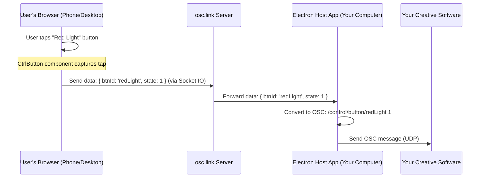

# Chapter 2: Controls (User Input Elements)

Welcome back! In [Chapter 1: Instance (Session Configuration)](01_instance__session_configuration__.md), we learned how an "Instance" sets up a unique event or "room" for your interactive experience, defining things like how many people can join and what the overall session is about.

Now, let's get to the fun part: how do users actually *interact*? If you want your audience to trigger a laser effect, change the background music, or type in a suggestion during a live show using their phones, they need something to tap, slide, or type on. That's where **Controls** come in!

## What's the Big Idea? Your Digital Toolkit

**Controls (User Input Elements)** are the interactive components that appear on a user's web browser (on their phone or computer) when they join an `osc.link` Instance. Think of them as the digital equivalent of buttons on a game controller, knobs on a synthesizer, or a touchpad.

Examples of Controls include:
*   **Buttons:** Tap to send a signal (e.g., "Play Sound," "Launch Firework").
*   **Toggles:** Switch something on or off (e.g., "Lights On/Off").
*   **Faders (Sliders):** Adjust a value along a range (e.g., "Volume," "Brightness").
*   **XY Touchpads:** Control two values at once by dragging a finger (e.g., positioning an object, controlling pitch and modulation).
*   **Text Input Fields:** Allow users to type and send text (e.g., "Enter Your Name," "Suggest a Song").

Each Instance configuration, which we learned about in Chapter 1, defines *which* of these controls are available to the users in that specific session. So, one Instance might have a single big red "LAUNCH!" button, while another might offer a complex dashboard with multiple faders and an XY pad.

## How Controls are Defined in an Instance

Remember the Instance configuration from Chapter 1? Controls are a key part of that setup. The admin who creates the Instance decides what interactive elements the users will get.

Let's look at a snippet from an Instance configuration, focusing on the `controls` section:

```json
// Simplified from Instance configuration
{
  "id": "2",
  "name": "DJ Request Booth",
  "settings": {
    "slots": 10,
    // ... other settings ...
    "controls": {
      "buttons": [
        { "id": "requestSong", "type": "button", "options": { "label": "Request Song" } }
      ],
      "texts": [
        { "id": "songName", "type": "text", "options": { "label": "Enter song title" } }
      ],
      "faders": [
        { "id": "moodSlider", "type": "fader", "options": { "label": "Mood (0-100)" } }
      ]
    }
  }
}
```
In this "DJ Request Booth" Instance:
*   Users will see a button labeled "Request Song" (with ID `requestSong`).
*   They'll have a text input field labeled "Enter song title" (ID `songName`).
*   And a fader (slider) to set a "Mood" (ID `moodSlider`).

`osc.link` uses a structure, often defined in TypeScript, to ensure these control definitions are consistent. Here's a simplified idea of what a `Control` object might look like:

```typescript
// Simplified from: packages/web/src/stores/socketStore.ts
export type Control = {
  id: string;          // Unique ID for this control, e.g., "laserButton"
  type: 'button' | 'xy' | 'toggle' | 'text' | 'fader'; // What kind of control is it?
  options: {           // Settings specific to this control type
    label?: string;    // Text displayed on/near the control
    icon?: string;     // An icon to display
    // ... other options like color, min/max for faders, etc.
  };
};
```
This `Control` type helps the system understand how to create and manage each interactive element. For example, a `type: 'button'` will be rendered differently and behave differently than a `type: 'fader'`.

## Seeing Controls: What the User Experiences

When a user joins an `osc.link` Instance via their web browser, the system reads the `controls` configuration for that Instance. It then dynamically builds the user interface, displaying the specified buttons, faders, etc.

The code responsible for showing these controls on the user's screen is in the web client part of `osc.link`. A central component, like `Controller` (found in `packages/web/src/components/Controller/index.tsx`), figures out which specific UI widgets to render based on the `type` of each control.

```tsx
// Conceptual idea from packages/web/src/components/Controller/index.tsx

// For each control defined in the Instance settings...
if (instance.settings.controls.buttons) {
  instance.settings.controls.buttons.forEach(buttonControl => {
    // Show a button component for each button defined
    // e.g., <CtrlButton id={buttonControl.id} {...buttonControl.options} />
  });
}
if (instance.settings.controls.xy) {
  instance.settings.controls.xy.forEach(xyControl => {
    // Show an XY Pad component
    // e.g., <CtrlXY id={xyControl.id} {...xyControl.options} />
  });
}
// ... and so on for texts, faders, toggles etc.
```
This means the `Controller` component looks at the list of controls defined for the Instance. If it sees a `"type": "button"`, it uses a `CtrlButton` component (like `packages/web/src/components/Controller/CtrlButton/index.tsx`) to draw the button. If it sees `"type": "xy"`, it uses `CtrlXY` (from `packages/web/src/components/Controller/CtrlXY/index.tsx`), and so on for all the different control types.

So, the user sees a custom interface perfectly tailored to the interactive experience designed by the admin!

## From a Tap to an OSC Message: The Journey

This is where the magic happens! How does tapping a button on a phone translate into an OSC message that your creative software can understand? Here's the typical journey:

1.  **User Interaction:** The user taps a button, drags a slider, or types text into a control on their web browser.
2.  **Web Client Captures Event:** The JavaScript code running in the browser (e.g., within a specific control component like `CtrlButton.tsx` or `CtrlXY.tsx`) detects this interaction.
3.  **Message Creation:** The web client creates a small data message describing the interaction. For example, tapping a button with ID "b1" might create a message like `{ message: 'button', btnId: 'b1', state: 1 }` (1 for pressed). An XY pad might send `{ message: 'paint', x: 0.75, y: 0.25 }`.
4.  **Sent to Server:** This data message is sent over the internet to the `osc.link` server using a technology called Socket.IO. We'll learn more about this in [Chapter 3: Socket Communication (Real-time Interaction)](03_socket_communication__real_time_interaction__.md).
5.  **Forwarded to Host:** The server receives this message and forwards it to the [Electron Host Application (OSC Bridge)](04_electron_host_application__osc_bridge__.md) that you (the event organizer/developer) are running on a computer connected to your creative software.
6.  **Conversion to OSC:** The Electron Host application takes the data message and converts it into a standard OSC (Open Sound Control) message. For example, `{ btnId: 'b1', state: 1 }` might become an OSC message like `/control/button/b1 1`.
7.  **OSC Message Sent:** The Electron Host sends this OSC message to your target application (like a music synthesizer, lighting desk, VJ software, or game engine) over your local network.

Let's visualize this flow:



This entire process happens very quickly, allowing for near real-time interaction!

## Under the Hood: A Peek at a Button's Code

Let's look at a highly simplified example of how a button control might send its state. Components like `CtrlButton.tsx` (in `packages/web/src/components/Controller/CtrlButton/index.tsx`) handle this.

```tsx
// Simplified concept from packages/web/src/components/Controller/CtrlButton/index.tsx

// Props for our button component (channelName is its unique ID)
// function CtrlButton({ channelName, label }) {

  // This function is called when the button is pressed down
  const handleBtnPress = () => {
    // 'socket' is our connection to the server
    socket.emit('OSC_CTRL_MESSAGE', { // Send a message named 'OSC_CTRL_MESSAGE'
      message: 'button',             // It's a button interaction
      btnId: channelName,            // The ID of this specific button
      state: 1,                      // 1 means 'pressed'
    });
  };

  // When the button is released, a similar message with 'state: 0' is sent.
// }
```
When the user presses the button, the `handleBtnPress` function is triggered. It uses `socket.emit(...)` to send a message called `OSC_CTRL_MESSAGE` to the server. This message contains:
*   `message: 'button'`: Tells the server this came from a button.
*   `btnId: channelName`: The unique ID of the button that was pressed (e.g., "redLight").
*   `state: 1`: A value indicating the button is now pressed (typically, 0 would be sent on release).

Other controls like `CtrlXY.tsx` for XY pads or `CtrlFader.tsx` for faders (sliders) work similarly. They capture user input (mouse/touch coordinates, slider values) and `socket.emit` a message with the relevant data. For example, an XY pad (`CtrlXY`) might send:

```javascript
// Conceptual: What an XY pad might send
socket.emit('OSC_CTRL_MESSAGE', {
  message: 'paint', // Or 'xy'
  x: 0.67,          // Normalized X coordinate (0.0 to 1.0)
  y: 0.32,          // Normalized Y coordinate (0.0 to 1.0)
});
```

## A Variety of Tools: Common Control Types

`osc.link` supports several common control types, each with its own UI component and way of sending data:

*   **Buttons (`CtrlButton`):** For momentary actions. Send a "pressed" (1) and "released" (0) state.
    *   *Example file: `packages/web/src/components/Controller/CtrlButton/index.tsx`*
*   **Toggles (`CtrlToggle`):** For persistent on/off states. Send their current state (e.g., 1 for ON, 0 for OFF) each time they are clicked.
    *   *Example file: `packages/web/src/components/Controller/CtrlToggle/index.tsx`*
*   **Faders/Sliders (`CtrlFader`):** For adjusting a continuous value (e.g., 0-255). Send the current value as the user drags them.
    *   *Example file: `packages/web/src/components/Controller/CtrlFader/index.tsx`*
*   **XY Pads (`CtrlXY`):** For controlling two values simultaneously (X and Y coordinates, usually normalized from 0.0 to 1.0). Send coordinates as the user drags their finger.
    *   *Example file: `packages/web/src/components/Controller/CtrlXY/index.tsx`*
*   **Text Inputs (`CtrlText`):** For users to type and submit text. Send the entered text when submitted.
    *   *Example file: `packages/web/src/components/Controller/CtrlText/index.tsx`*

By combining these controls in an Instance, you can create a vast range of interactive experiences!

## Conclusion: Your Users' Hands-On Tools

You've now learned about **Controls (User Input Elements)** – the vital link that allows your audience or participants to interact with your `osc.link` session. These are the buttons, sliders, and touchpads defined within an [Instance (Session Configuration)](01_instance__session_configuration__.md) that appear on users' screens.

When a user interacts with a control, their browser sends a message detailing this action. This message travels through the `osc.link` system, ultimately becoming an OSC message that your creative software can act upon.

So, we know *what* users interact with (Controls) and *how* these controls are set up (in an Instance). But how does that interaction data actually travel from the user's phone to the server in real-time?

Next, we'll dive into the communication backbone that makes this possible: [Chapter 3: Socket Communication (Real-time Interaction)](03_socket_communication__real_time_interaction__.md).

---

Generated by [AI Codebase Knowledge Builder](https://github.com/The-Pocket/Tutorial-Codebase-Knowledge)