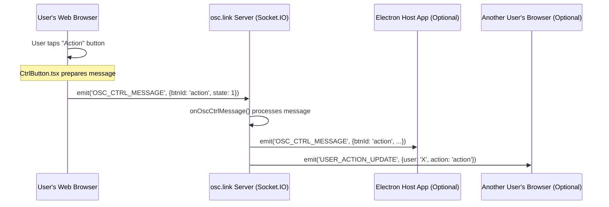

# Chapter 3: Socket Communication (Real-time Interaction)

In [Chapter 1: Instance (Session Configuration)](01_instance__session_configuration__.md), we learned how `osc.link` sets up a unique "room" or "Instance" for an interactive event. Then, in [Chapter 2: Controls (User Input Elements)](02_controls__user_input_elements__.md), we saw how users get interactive elements like buttons and sliders on their screens.

Now, let's connect these pieces. If a user taps a button on their phone, how does that action *instantly* travel to the main `osc.link` server, and then perhaps to an [Electron Host Application (OSC Bridge)](04_electron_host_application__osc_bridge__.md) running on a local computer to trigger something in your creative software? This chapter is all about that magical, super-fast communication!

## What's the Big Idea? The Project's Nervous System

Imagine you're playing an online game with friends. When you move your character, everyone else sees it happen almost immediately. Or, if you send a chat message, it pops up on their screens right away. This is **real-time interaction**.

**Socket Communication** is the technology that makes this possible in `osc.link`. It's like the project's nervous system, carrying messages quickly and efficiently between:
1.  **Users' web browsers** (where they see and use the [Controls (User Input Elements)](02_controls__user_input_elements__.md)).
2.  The central **`osc.link` server**.
3.  The **[Electron Host Application (OSC Bridge)](04_electron_host_application__osc_bridge__.md)** (if one is connected to your session).

Think of it as a set of **live telephone lines**.
*   When a user interacts with a control (e.g., taps a button), a message is instantly sent over their "telephone line" to the server.
*   The server then acts like an operator:
    *   It can relay this message to the Electron Host application, which might turn it into an OSC message for a local music or visual program.
    *   It can also inform other users in the same session about what happened (e.g., "Player 2 just pressed the red button!").
    *   It tells users when new people join or leave the session.

This continuous, two-way flow of information is what makes `osc.link` feel alive and responsive. `osc.link` uses a popular library called **Socket.IO** to handle these "telephone lines."

## Key Concepts of Socket Communication

1.  **Sockets:** These are the endpoints of our communication "telephone lines." Your web browser has a socket, the server has a socket, and the Electron Host app has a socket. They connect to each other to talk.

2.  **Real-time:** Messages are sent and received with very little delay. You don't have to wait for a page to reload; things just happen.

3.  **Two-way (Bidirectional):**
    *   Your browser can send messages *to* the server (e.g., "I pressed a button!").
    *   The server can send messages *to* your browser (e.g., "A new user joined!" or "The host changed the game state!").

4.  **Event-driven:** Communication happens based on "events."
    *   *Event:* User presses a button.
    *   *Action:* Browser *emits* (sends) a "button_pressed" message.
    *   *Event:* Server receives "button_pressed" message.
    *   *Action:* Server *emits* an "update_display" message to other users.
    *   Clients and the server *listen* for specific events they care about.

5.  **Socket.IO:** This is a JavaScript library that makes setting up and managing these socket connections much easier. It handles complexities like temporarily losing internet connection and trying to reconnect automatically. Both the web client (browser part) and the server part of `osc.link` use Socket.IO.

## How `osc.link` Uses Socket Communication

Let's revisit our example: A user in an `osc.link` session taps a button on their phone.

1.  **User Taps Button:** The user interacts with a [Control (User Input Element)](02_controls__user_input_elements__.md) in their web browser.
    *   The browser's JavaScript code (like in `CtrlButton.tsx`) detects this.

2.  **Client Sends Message:** The browser uses its Socket.IO connection to *emit* (send) a message to the `osc.link` server. This message contains details like which button was pressed and by whom.
    ```javascript
    // Conceptual: Inside CtrlButton.tsx on the user's browser
    // 'socket' is our connection to the server, established earlier.
    socket.emit('OSC_CTRL_MESSAGE', {
      message: 'button',
      btnId: 'launchRocket',
      state: 1 // 1 for pressed
    });
    ```
    This code sends an event named `OSC_CTRL_MESSAGE` with some data about the button press.

3.  **Server Receives Message:** The `osc.link` server is constantly *listening* for messages from connected clients. When it receives the `OSC_CTRL_MESSAGE`:
    *   The server-side Socket.IO code (in `packages/server/src/socket.ts`, specifically functions like `onOscCtrlMessage`) processes this message.
    ```javascript
    // Conceptual: Inside packages/server/src/socket.ts on the server
    // 'socket' here represents the connection to a specific user's browser.
    socket.on('OSC_CTRL_MESSAGE', (data) => {
      console.log('Server received:', data.btnId, 'pressed by user:', socket.id);
      // Now, what to do with this information?
    });
    ```

4.  **Server Relays/Broadcasts Information:**
    *   **To Electron Host:** If an [Electron Host Application (OSC Bridge)](04_electron_host_application__osc_bridge__.md) is connected to this session (Instance), the server forwards the relevant information to it.
        ```javascript
        // Conceptual: Server relaying to Electron Host
        // 'io' is the main server socket object
        // 'instance.rooms.control' is a specific "channel" for this session's host
        io.to(instance.rooms.control).emit('OSC_CTRL_MESSAGE', {
          ...data, // The original button data
          client_index: socket.data.assignedClientSlotIndex // Who pressed it
        });
        ```
        The Electron Host listens for this message and then translates it into an OSC message for your local software.
    *   **To Other Users:** The server might also notify other users in the same session. For example, if it's a collaborative drawing app, other users need to see the new line being drawn. Or it might just update them on who is active.
        ```javascript
        // Conceptual: Server updating other users (if needed)
        // 'instance.rooms.users' is a channel for all users in this session
        io.to(instance.rooms.users).emit('USER_ACTION_UPDATE', {
          user: socket.id,
          action: 'pressed_launch_rocket'
        });
        ```
    *   **Joining/Leaving:** When a user joins or leaves an Instance, the server uses Socket.IO to inform everyone connected to that Instance.
        *   The client (e.g., in `packages/web/src/components/Controller/index.tsx`) listens for events like `USER_JOINED` or `USER_LEFT` to update its display.
        *   The server (e.g., in `packages/server/src/socket.ts`) emits these events when connections change.

This rapid exchange of messages is what makes the interaction feel instant.

## Under the Hood: A Quick Tour

Let's visualize the basic flow when a user presses a button:



**1. Establishing the Connection:**

*   **Client-Side (Web Browser):** When you open an `osc.link` page, your browser needs to connect to the Socket.IO server.
    *   Code in `packages/web/src/contexts/socketContext.tsx` sets this up:
    ```javascript
    // Simplified from packages/web/src/contexts/socketContext.tsx
    import { io } from 'socket.io-client';
    import config from '../config';

    // Connect to the server URL defined in config
    export const socket = io(config.socketServer, { secure: true });
    ```
    This `socket` object is then used throughout the web application to send and receive messages. A similar setup happens in the [Electron Host Application (OSC Bridge)](04_electron_host_application__osc_bridge__.md) (see `packages/electron/src/contexts/socketContext.tsx`).

*   **Server-Side:** The `osc.link` server starts its Socket.IO service and waits for clients to connect.
    *   Code in `packages/server/src/socket-server.ts` initializes this:
    ```javascript
    // Simplified from packages/server/src/socket-server.ts
    import { Server } from "socket.io";
    // 'httpServer' is the underlying web server

    let io = new Server(httpServer, { /* CORS settings */ });

    io.on("connection", (socket) => { // A new client just connected!
      console.log("A user connected with ID:", socket.id);
      // ... set up listeners for messages from this specific client ...
    });
    ```
    When `io.on("connection", ...)` happens, it means a new "telephone line" is open with a client. The `socket` object inside that function represents that specific client's connection.

**2. Sending and Receiving Messages:**

*   **Client Sending (Emitting):** As seen before, components like `CtrlButton.tsx` use `socket.emit('EVENT_NAME', data);`.

*   **Server Receiving:** The server listens for specific events from clients using `socket.on('EVENT_NAME', callback);`.
    *   In `packages/server/src/socket.ts`, you'll find handlers like `onOscCtrlMessage` which are attached to these events.
    ```javascript
    // Simplified: packages/server/src/socket.ts function being called
    export async function onOscCtrlMessage({ socket, data, io }) {
      // socket: the client who sent the message
      // data: the payload (e.g., { message: 'button', btnId: 'b1', ... })
      // io: the main server socket object, to broadcast to others
      console.log(`Received '${data.message}' for button '${data.btnId}'`);

      // Relay to the Electron Host for this instance
      const instance = await getInstance(socket.data.instanceId);
      if (instance) {
        io.to(instance.rooms.control).emit('OSC_CTRL_MESSAGE', { /* ... */ });
      }
    }
    ```

*   **Server Sending (Emitting):** The server can send a message back to the original sender (`socket.emit(...)`), or to everyone connected (`io.emit(...)`), or to everyone in a specific "room" (`io.to(roomName).emit(...)`).
    *   `osc.link` uses **rooms** heavily. For example, all users in Instance "alpha-bravo" join a Socket.IO room named something like `users:alpha-bravo`. The Electron host for that instance joins `control:alpha-bravo`. This allows the server to target messages precisely.

*   **Client Receiving:** The client-side JavaScript (e.g., in `packages/web/src/components/Controller/index.tsx`) listens for messages from the server using `socket.on('EVENT_NAME', callback);`.
    ```javascript
    // Simplified from packages/web/src/components/Controller/index.tsx
    useEffect(() => {
      socket.on('USER_JOINED', (data) => {
        console.log('Another user joined!', data.users);
        // Update the display to show the new list of users
        socketStore.updateRoomState({ users: data.users });
      });

      socket.on('OSC_HOST_MESSAGE', (data) => {
        console.log('Message from host:', data);
        // Update game state based on host message
        gameStore.handleUpdate(data);
      });

      // Cleanup listeners when component is removed
      return () => {
        socket.off('USER_JOINED');
        socket.off('OSC_HOST_MESSAGE');
      };
    }, [socket, socketStore, gameStore]); // Dependencies
    ```
    This code sets up listeners for `USER_JOINED` (when someone else joins your session) and `OSC_HOST_MESSAGE` (messages coming from the Electron Host, relayed by the server).

This constant back-and-forth of emitting and listening to events over the socket connections is the core of `osc.link`'s real-time capabilities.

## Conclusion: The Lifeblood of Interaction

You've now seen how **Socket Communication**, powered by **Socket.IO**, acts as the rapid transit system for messages in `osc.link`. It's what enables your taps and drags on [Controls (User Input Elements)](02_controls__user_input_elements__.md) within a specific [Instance (Session Configuration)](01_instance__session_configuration__.md) to have immediate effects, whether it's triggering something locally via the Electron Host or updating other participants' views.

This real-time, two-way communication is truly the nervous system of the project, making interactive experiences feel dynamic and connected.

So, we've covered how sessions are set up, what users interact with, and how their actions are communicated. But what about that special piece of software that bridges `osc.link` to your local applications like music software or lighting desks?

Next, we'll explore the dedicated component that makes this local connection possible: [Chapter 4: Electron Host Application (OSC Bridge)](04_electron_host_application__osc_bridge__.md).

---

Generated by [AI Codebase Knowledge Builder](https://github.com/The-Pocket/Tutorial-Codebase-Knowledge)