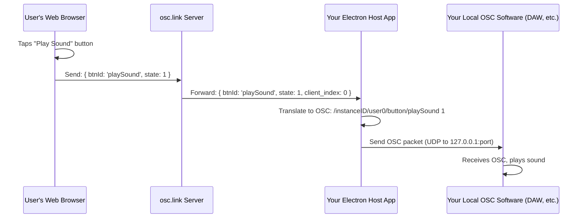

# Chapter 4: Electron Host Application (OSC Bridge)

Welcome back! In [Chapter 3: Socket Communication (Real-time Interaction)](03_socket_communication__real_time_interaction__.md), we saw how messages fly back and forth between users' web browsers and the `osc.link` server in real-time. This is fantastic for web-based interactions.

But what if you want those interactions to control software running directly on *your* computer? For example, you want a button pressed on a phone in an `osc.link` session to trigger a sound in your Digital Audio Workstation (DAW) like Ableton Live, or change visuals in a media server like Resolume Arena. This is where the **Electron Host Application** comes in!

## What's the Big Idea? Connecting the Web to Your Local Software

Imagine you've designed a cool interactive experience using `osc.link`. Participants use their phones, tapping buttons and moving sliders that you've set up in an [Instance (Session Configuration)](01_instance__session_configuration__.md). How do you get those taps and slides to actually *do* something in applications on your computer?

The **Electron Host Application (OSC Bridge)** is a special desktop program you run on your own computer. Its main job is to act as a **bridge**:
1.  It connects to the `osc.link` server for a specific session (an "Instance").
2.  It listens for all the control messages coming from participants' web browsers (via the `osc.link` server).
3.  It translates these web messages into **OSC (Open Sound Control)** messages. OSC is a common language that many creative applications (DAWs, VJ software, game engines, lighting controllers) understand.
4.  It then sends these OSC messages to the creative application running on your computer.

Think of it like a real-time translator and local delivery service. It takes messages from the global `osc.link` web world and delivers them in a format your local software can understand, right to its doorstep (a specific IP address and port on your computer).

This allows you, the "admin" or event operator, to integrate `osc.link` deeply with your existing professional tools.

## Key Parts of the Electron Host App

1.  **Electron App:** "Electron" is a framework that lets developers build desktop applications using web technologies (like HTML, CSS, and JavaScript). The `osc.link` Host Application is built with Electron, so it feels like a native app but shares a lot of technology with the web platform.
    *   *Code context: The entire `packages/electron` directory is dedicated to this application.*

2.  **Instance Selection:** When you run the Electron Host App, you first choose which `osc.link` [Instance (Session Configuration)](01_instance__session_configuration__.md) you want to "host." This tells the app which session's messages it should listen to.
    *   *Code context: The `SessionList` component (`packages/electron/src/components/SessionList/index.tsx`) fetches and displays available Instances.*

3.  **OSC Configuration:** You need to tell the Electron Host App where your local OSC-capable application is "listening." This usually means specifying:
    *   **IP Address:** Often `127.0.0.1` (which means "this same computer").
    *   **Port Number:** A specific number (e.g., `57121`) that your target application is configured to receive OSC messages on.
    *   *Code context: The `OSCPorts` component (`packages/electron/src/components/OSCPorts/index.tsx`) allows you to set these values.*

4.  **Socket.IO Client:** Just like the web browsers of participants, the Electron Host App uses [Socket Communication (Real-time Interaction)](03_socket_communication__real_time_interaction__.md) to connect to the `osc.link` server and receive messages. It joins a special "control" room for the Instance it's hosting.

5.  **OSC Sender:** Once it receives a control message (e.g., "button 'b1' pressed"), it formats an OSC message (e.g., `/osc-link/instanceX/userY/button/b1 1`) and sends it via UDP (User Datagram Protocol) to the IP address and port you configured.

## How It Works: From Web Click to Local Action

Let's walk through the journey of a message when an Electron Host App is involved:

1.  **Setup by Admin:**
    *   You (the admin) download and run the `osc.link` Electron Host Application on your computer (the one running your DAW, media server, etc.).
    *   You log in and select the `osc.link` Instance you want to control from the list of available sessions. (See `packages/electron/src/components/SessionList/index.tsx`)
    *   You configure the Remote OSC Port (where your local software is listening) and optionally the Local OSC Port (which the Host App uses to send from, less commonly changed). (See `packages/electron/src/components/OSCPorts/index.tsx`)
    *   The Electron Host App connects to the `osc.link` server and says, "I'm hosting Instance 'XYZ'!"

2.  **User Interaction:**
    *   A participant opens the `osc.link` interface for Instance 'XYZ' in their web browser.
    *   They tap a [Control (User Input Element)](02_controls__user_input_elements__.md), like a button.

3.  **Message Flow (recap from Chapter 3, then new steps):**
    *   The participant's browser sends a message (e.g., `{ message: 'button', btnId: 'redButton', state: 1 }`) to the `osc.link` server via Socket.IO.
    *   The `osc.link` server knows your Electron Host App is hosting Instance 'XYZ'.
    *   **NEW:** The server relays this message to *your* Electron Host App (also via Socket.IO).
    *   **NEW:** Your Electron Host App receives the message.
    *   **NEW:** It translates this JSON-like message into an OSC packet. For example:
        *   OSC Address: `/osc-link/XYZ/user2/button/redButton` (Instance ID, user slot, control type, control ID)
        *   OSC Value: `1` (for pressed)
    *   **NEW:** The Electron Host App sends this OSC packet via UDP to `127.0.0.1` on the port you specified (e.g., port `57121`).
    *   **NEW:** Your local creative application (DAW, VJ software, etc.), which is listening on `127.0.0.1:57121` for OSC messages, receives this message and performs an action (e.g., plays a sound, triggers a video clip).

This whole process happens very fast, creating a real-time link!

Here’s a visual:


## Using the Electron Host Application

As described in its `README.md` (`packages/electron/README.md`):
1.  **Download:** Get the latest version for your operating system from the releases page.
2.  **Launch:** Run the application.
3.  **Connect:**
    *   You'll see a list of "Available Sessions" (Instances).
        ```javascript
        // Conceptual: Fetching instances (packages/electron/src/components/SessionList/index.tsx)
        // async function fetchInstances() {
        //   const response = await fetch(`${config.webSocketHost}/api/instances`, { /* auth headers */ });
        //   const instances = await response.json();
        //   // socketStore.setAvailableInstances(instances); // Update UI
        // }
        ```
        This list is fetched from the `osc.link` server API.
    *   Click "Connect" for the Instance you want to host.
4.  **Configure OSC Ports:**
    *   On the session page, you'll see inputs for "Remote OSC Port" and "Local OSC Port".
    *   Enter the port number your target application is listening on for "Remote OSC Port". The default is often `57121` (from `packages/electron/src/config/index.ts`).
    *   The "Local OSC Port" (default `56121`) is what the Electron app sends *from*. Usually, you don't need to change this unless there's a port conflict on your machine.
        ```tsx
        // Conceptual: OSCPorts.tsx from packages/electron/src/components/OSCPorts/index.tsx
        // <Form.Control
        //   type="number"
        //   defaultValue={socketStore.oscRemotePort} // From MobX store
        //   onChange={(e) => socketStore.setOscRemotePort(Number(e.target.value))}
        // />
        // /* Similar for local port */
        ```
        These UI elements update values in a [State Management (MobX Stores)](06_state_management__mobx_stores__.md) (`socketStore`).
5.  **Start Hosting:**
    *   Once an Instance is selected and ports are configured, the app effectively starts the bridge.
    *   In `packages/electron/src/components/App/Pages/Session.tsx`, this is triggered:
        ```javascript
        // Simplified from Session.tsx
        // useEffect(() => {
        //   if (instanceId) {
        //     window.electronAPI.serverStart(instanceId, socketStore.oscLocalPort, socketStore.oscRemotePort);
        //   }
        //   return () => window.electronAPI.serverStop();
        // }, [instanceId, socketStore.oscLocalPort, socketStore.oscRemotePort]);
        ```
        `window.electronAPI.serverStart(...)` is key. It's a function exposed from Electron's "main process" (the Node.js backend part of Electron) to its "renderer process" (the UI part). This tells the main process to:
        *   Connect to the `osc.link` Socket.IO server for the given `instanceId`.
        *   Start listening for messages.
        *   Prepare to send OSC messages to the specified `oscRemotePort`.

6.  **Monitor:** The Electron Host App often provides a log (`SessionLog`) to show incoming messages and outgoing OSC activity, helping you troubleshoot.

## Under the Hood: Electron's Main and Renderer Processes

Electron apps have two main types of processes:
*   **Main Process:** There's only one. It's like the backend of your desktop app. It can do things like create windows, manage files, and handle network communication that the UI can't do directly (like raw UDP for OSC).
*   **Renderer Processes:** Each window in an Electron app runs its own renderer process. This is like a web page in a browser tab. It's responsible for displaying the UI (HTML, CSS, React components).

Communication between these processes happens via "Inter-Process Communication" (IPC). `window.electronAPI` is a common pattern using Electron's "preload scripts" to safely expose specific main process functions to the renderer process.

**Simplified flow inside the Electron App when `serverStart` is called:**

1.  **Renderer (UI - `Session.tsx`):** Calls `window.electronAPI.serverStart(instanceId, localPort, remotePort)`.
2.  **IPC Bridge (Preload Script):** Relays this call and arguments to the main process.
3.  **Main Process (e.g., `electron/main.ts` - conceptual):**
    *   Receives the `serverStart` command.
    *   Establishes a Socket.IO connection to the `osc.link` server (`config.webSocketHost`).
        ```javascript
        // Conceptual: Electron Main Process - Socket.IO setup
        // import io from 'socket.io-client';
        // import config from './config'; // Electron app's config
        // const socket = io(config.webSocketHost);
        // socket.emit('JOIN_AS_HOST', { instanceId }); // Tell server we are a host
        ```
    *   Sets up an OSC client (using a library like `node-osc`) to send UDP packets to the configured `remotePort`.
        ```javascript
        // Conceptual: Electron Main Process - OSC client setup
        // import { Client as OscClient } from 'node-osc';
        // const oscClient = new OscClient('127.0.0.1', remotePort);
        ```
    *   Listens for `OSC_CTRL_MESSAGE` events from the `osc.link` server via the socket connection.
        ```javascript
        // Conceptual: Electron Main Process - Receiving messages and sending OSC
        // socket.on('OSC_CTRL_MESSAGE', (data) => {
        //   // data might be: { message: 'button', btnId: 'b1', state: 1, client_index: 0 }
        //   // Construct OSC address, e.g., /instanceId/user0/button/b1
        //   const oscAddress = `/inst/${instanceId}/user${data.client_index}/${data.message}/${data.btnId}`;
        //   const oscValue = data.state; // Or data.x, data.y etc.
        //
        //   oscClient.send(oscAddress, oscValue, () => { /* Sent! */ });
        //   // Also, might send this log back to renderer for display
        //   // event.sender.send('LOG_MESSAGE', `OSC Sent: ${oscAddress} ${oscValue}`);
        // });
        ```
    *   When a message arrives, it translates it and uses the `oscClient` to send the OSC packet.

This separation allows the UI to be responsive while the main process handles the heavy lifting of network communication and OSC translation.

## Conclusion: Your Local Link to `osc.link`

The **Electron Host Application (OSC Bridge)** is a vital component for creators who want to connect the web-based interactivity of `osc.link` with professional audio, visual, or lighting software running on their local computers. It acts as a dedicated listener and translator, converting web control messages into the OSC language that these applications understand.

By running this application, selecting an [Instance (Session Configuration)](01_instance__session_configuration__.md) to host, and configuring your local OSC target, you unlock the power to control your local setup from any device with a web browser, anywhere in the world (as long as it can reach your `osc.link` Instance).

We've seen how users interact, how messages travel, and now how those messages can reach local software. But how does the `osc.link` server manage all these Instances, and keep track of who is in which "slot" or "seat" in an interactive session?

Next, we'll delve into the server's role in organizing these experiences: [Chapter 5: Server-Side Instance & Slot Management](05_server_side_instance___slot_management_.md).

---

Generated by [AI Codebase Knowledge Builder](https://github.com/The-Pocket/Tutorial-Codebase-Knowledge)