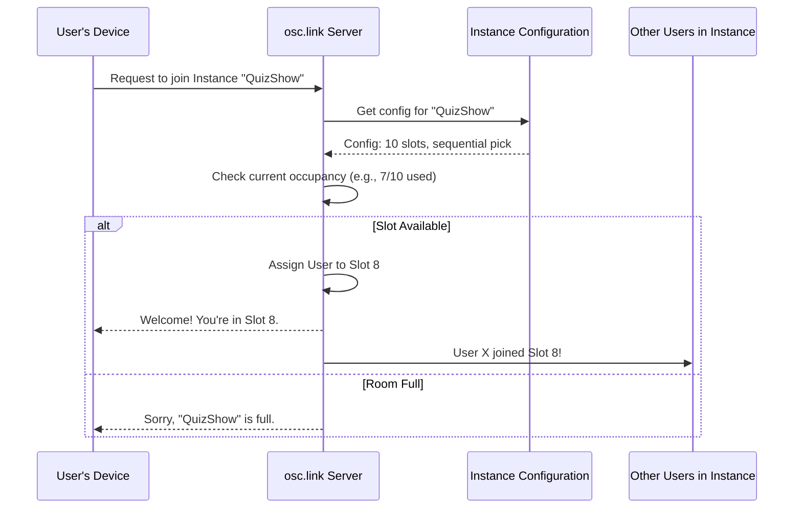

# Chapter 5: Server-Side Instance & Slot Management

Welcome back! In [Chapter 4: Electron Host Application (OSC Bridge)](04_electron_host_application__osc_bridge__.md), we explored how the `osc.link` Electron app can bridge interactions from the web to software running on your local computer. We've seen how users can interact with [Controls (User Input Elements)](02_controls__user_input_elements__.md) within an [Instance (Session Configuration)](01_instance__session_configuration__.md), and how those messages are sent using [Socket Communication (Real-time Interaction)](03_socket_communication__real_time_interaction__.md).

But who makes sure that an Instance doesn't get too crowded? How does a user get assigned a specific "seat" or "slot" in an interactive experience? And how are other participants informed when someone joins or leaves? This is where the `osc.link` server steps in as a manager.

## What's the Big Idea? The "Session Manager"

Imagine an interactive online game or a collaborative workshop. Each session (which we call an "Instance" in `osc.link`) might have a limited number of participants. The **`osc.link` server** acts like a diligent **session manager** or a **restaurant host**.

Its job is to:
1.  **Know the Rules:** For each Instance, the server knows its configuration, like the maximum number of participants allowed (max slots) and how participants should be assigned to these slots (e.g., first-come-first-served, random, or letting users pick). This configuration is defined when an admin creates an [Instance (Session Configuration)](01_instance__session_configuration__.md).
2.  **Manage "Slots":** Think of "slots" as the available "seats" in your interactive session. The server keeps track of which slots are occupied and which are free.
3.  **Handle Arrivals:** When a new user tries to join an Instance:
    *   The server checks if there's an empty slot.
    *   If yes, it assigns the user to a slot according to the Instance's rules.
    *   It then informs the new user they've successfully joined and tells everyone else in that Instance about the new participant.
4.  **Handle Departures:** When a user disconnects or leaves:
    *   The server frees up their slot, making it available for someone else.
    *   It informs the remaining participants that someone has left.

This server-side logic ensures that each interactive session operates smoothly and according to its defined rules, preventing overcrowding and managing participation fairly.

## Key Parts of Instance & Slot Management

Let's look at the main components the server uses to manage this:

*   **The Instance's Blueprint (from [Chapter 1](01_instance__session_configuration__.md)):**
    When an admin creates an Instance, they define settings like:
    *   `slots`: The maximum number of users allowed.
    *   `sequentialPick`: Assign slots in order (1, 2, 3...).
    *   `randomPick`: Assign users to any random available slot.
    *   `slotPick`: Allow users to request a specific slot number.
    The server reads this blueprint to know how to manage the session.

*   **User "Slots":**
    These are the virtual "seats" available in an Instance. If an Instance has `slots: 4`, there are four potential spots for users. The server needs to know which ones are taken.

*   **Joining an Instance:**
    When a user attempts to join, the server executes a series of checks and actions to place them in a slot, if possible.

*   **Leaving an Instance:**
    When a user leaves, the server updates its records to show that the slot is now free.

## The User's Journey: Joining a Session

Let's follow a user trying to join an `osc.link` Instance:

1.  **User Request:** The user clicks a link or scans a QR code to join a specific Instance (e.g., "InteractiveQuizShow"). Their browser sends a "join request" message to the `osc.link` server.
2.  **Server Receives:** The server gets this request. It knows which Instance the user wants to join.
3.  **Server Consults Configuration:**
    *   It looks up the configuration for "InteractiveQuizShow." Let's say it finds: `max slots: 10`, `sequentialPick: true`.
4.  **Server Checks Occupancy:**
    *   It checks how many users are *currently* in "InteractiveQuizShow." Let's say 7 out of 10 slots are already taken.
5.  **Server Decides & Acts:**
    *   **If a slot is available:** Since 7 < 10, there's room! Because it's `sequentialPick`, and slots 1-7 are taken, the server assigns the new user to Slot 8.
        *   It sends a "join accepted" message back to the new user, telling them their slot number.
        *   It sends a "user joined" message to all other users (and the [Electron Host Application (OSC Bridge)](04_electron_host_application__osc_bridge__.md), if connected) in "InteractiveQuizShow," informing them that a new user is now in Slot 8.
    *   **If the Instance is full:** If all 10 slots were already taken, the server would send a "join rejected" message to the user, perhaps saying "Sorry, this session is full."

Here's a simplified diagram of this process:



## Under the Hood: How the Server Manages This

The server needs to keep track of all this information. It does so using a combination of database records and in-memory data structures for active sessions.

**1. Storing Instance State:**

*   **Persistent Configuration (`packages/server/src/models/Instance.ts`):**
    The basic definition of an Instance (ID, name, settings like max slots, control definitions) is stored in a database. This is the permanent blueprint.
    ```typescript
    // Simplified from packages/server/src/models/Instance.ts
    class Instance extends Model {
      public id!: string;
      public name!: string;
      public settings?: {
        slots: number; // Max number of users
        randomPick?: boolean;
        sequentialPick?: boolean;
        // ... other settings
      };
      // ... other fields
    }
    ```
    This `Instance` model tells the server the fundamental rules for any given session.

*   **Live Session Data (`packages/server/src/inMemoryInstances.ts`):**
    For Instances that are currently active (users are connected), the server keeps additional information in its memory. This is more dynamic.
    The `InstanceInMemoryData` type combines the database info with live data:
    ```typescript
    // Simplified structure from packages/server/src/inMemoryInstances.ts
    export type InstanceInMemoryData = Instance & { // Inherits from DB Model
      rooms: { users: string; control: string }; // Socket.IO room names
      instanceSlots: InstanceSlot[];             // Tracks each slot
      connectedClients: ConnectedClient[];       // List of users
      lastTriedSlotIndex: number;              // For sequential assignment
    };
    ```
    *   `instanceSlots`: This is an array where each element represents a slot in the Instance.
        ```typescript
        // From packages/server/src/inMemoryInstances.ts
        export type InstanceSlot = {
          slot_index: number;    // e.g., 1, 2, 3...
          client: Socket | undefined; // Who is in this slot? (Socket is a user connection)
        };
        ```
        If `client` is `undefined`, the slot is free. Otherwise, it holds the connection object of the user in that slot.
    *   `connectedClients`: A simple list of users currently in the instance.

*   **Loading an Instance (`getInstance` from `packages/server/src/inMemoryInstances.ts`):**
    When the server needs to work with an Instance (e.g., when the first user tries to join), it uses a function like `getInstance`. This function fetches the Instance's configuration from the database and prepares its live session data, including initializing the `instanceSlots` array.
    ```javascript
    // Conceptual: Initializing slots in getInstance
    async function getInstance(instanceId) {
      // ... fetch 'instance' from database ...
      let instanceSlots = [];
      const numSlots = instance.settings.slots || 0;
      for (let i = 0; i < numSlots; i++) {
        instanceSlots.push({ slot_index: i + 1, client: undefined }); // Slot is free
      }
      // ... store this prepared data in memory ...
      // instances[instanceId] = { ...instanceData, instanceSlots };
      return instances[instanceId];
    }
    ```
    This ensures that when an Instance becomes active, the server knows exactly how many slots it has and that they are all initially empty.

**2. Handling a Join Request (`onUserJoinRequest` in `packages/server/src/socket.ts`):**

This function is triggered when a user's browser sends a "USER_JOIN_REQUEST" message via [Socket Communication (Real-time Interaction)](03_socket_communication__real_time_interaction__.md).

```javascript
// Simplified from packages/server/src/socket.ts
export async function onUserJoinRequest({ socket, data, io }) {
  const instanceId = data.room.split(':')[1]; // Get Instance ID from request
  const instance = await getInstance(instanceId); // Load instance data

  if (!instance) { /* Handle error */ return; }

  // 'socket' is the new user trying to join
  // 'data.wantsSlot' might be a specific slot number the user requests
  let assignedSlotIndex = assignClientSlot(instance, /*roomState*/{}, socket, data.wantsSlot);

  if (assignedSlotIndex === false) {
    // Room is full or slot not assignable
    socket.emit("USER_JOIN_REJECTED", { reason: "Room is full or slot unavailable." });
  } else {
    socket.data.assignedClientSlotIndex = assignedSlotIndex; // Store on user's connection
    socket.data.instanceId = instance.id;
    socket.join(instance.rooms.users); // Add user to Socket.IO room for this Instance

    socket.emit("USER_JOIN_ACCEPTED", { userSlot: assignedSlotIndex });
    // Notify other users in the Instance and the Electron Host
    io.to(instance.rooms.users).emit("USER_JOINED", { /* details */ });
    io.to(instance.rooms.control).emit("OSC_CTRL_USER_JOINED", { /* details */ });
  }
}
```
This function orchestrates the joining process:
1.  It gets the live data for the target Instance using `getInstance`.
2.  It calls `assignClientSlot` (from `packages/server/src/utils.ts`) to figure out if and where the user can be placed.
3.  Based on the result, it either rejects the user or accepts them, updating records and notifying everyone.

**3. Assigning a Slot (`assignClientSlot` in `packages/server/src/utils.ts`):**

This utility function contains the core logic for deciding which slot a user gets.

```javascript
// Simplified logic from packages/server/src/utils.ts
export function assignClientSlot(instance, roomState, newClient, requestedSlotIndex) {
  // 1. Handle specific slot request (slotPick)
  if (requestedSlotIndex) {
    const targetSlot = instance.instanceSlots.find(s => s.slot_index === requestedSlotIndex);
    if (targetSlot && !targetSlot.client) { // If slot exists and is free
      targetSlot.client = newClient; // Assign user to this slot
      return requestedSlotIndex;
    }
    // If slot taken or doesn't exist, might fall through or reject
  }

  // 2. Check if Instance is full
  const usedSlots = instance.instanceSlots.filter(s => s.client).length;
  if (usedSlots >= instance.settings.slots) {
    return false; // No space!
  }

  // 3. Find next available slot (sequentialPick or randomPick logic)
  // For sequential:
  let nextFreeSlot = instance.instanceSlots.find(s => !s.client);
  // For random: pick a random slot from instance.instanceSlots.filter(s => !s.client)

  if (nextFreeSlot) {
    nextFreeSlot.client = newClient; // Assign user
    return nextFreeSlot.slot_index;
  }
  return false; // Should not happen if not full, but good fallback
}
```
This function checks various conditions:
*   If the user requested a specific slot and it's free (and `slotPick` is enabled for the Instance).
*   If the Instance is already full.
*   It then finds an available slot based on the Instance's `sequentialPick` or `randomPick` setting.
*   It updates the `instance.instanceSlots` array by assigning the `newClient` (the user's connection) to the chosen slot.

**4. Handling a Disconnection (`onDisconnect` in `packages/server/src/socket.ts`):**

When a user closes their browser or loses connection, the server's `disconnect` event handler for their socket connection is triggered.

```javascript
// Simplified from packages/server/src/socket.ts
export async function onDisconnect({ socket, io }) {
  const instanceId = socket.data.instanceId;
  if (!instanceId) return; // User wasn't in an instance

  const instance = await getInstance(instanceId);
  if (!instance) return;

  resetClientSlot(instance, socket); // Mark the slot as free

  // Notify other users and the Electron Host
  io.to(instance.rooms.users).emit("USER_LEFT", { /* user details */ });
  io.to(instance.rooms.control).emit("OSC_CTRL_USER_LEFT", { /* user details */ });

  console.log("User disconnected and slot freed:", socket.id);
}
```
This function:
1.  Identifies which Instance and slot the disconnected user occupied (this info was stored on `socket.data` when they joined).
2.  Calls `resetClientSlot` to free up that slot.
3.  Notifies other participants.

**5. Freeing a Slot (`resetClientSlot` in `packages/server/src/utils.ts`):**

This utility function updates the `instanceSlots` array to mark a slot as available again.

```javascript
// Simplified from packages/server/src/utils.ts
export function resetClientSlot(instance, clientSocketToReset) {
  instance.instanceSlots = instance.instanceSlots.map(slot => {
    if (slot.client && slot.client.id === clientSocketToReset.id) {
      return { ...slot, client: undefined }; // Set client to undefined (slot is free)
    }
    return slot;
  });
}
```
It finds the slot occupied by the disconnected user (`clientSocketToReset`) and sets its `client` property back to `undefined`.

## Conclusion: Orderly and Fair Sessions

The `osc.link` server's role in **Instance & Slot Management** is crucial for creating organized and predictable interactive experiences. By acting as a "session manager," it enforces the rules set in the [Instance (Session Configuration)](01_instance__session_configuration__.md), handles users joining and leaving, assigns them to available "slots," and keeps everyone informed. This ensures that your `osc.link` sessions run smoothly, whether they're for a handful of users or a larger group.

Now that we understand how the server manages participants and session rules, how do the client applications (like the user's web browser or the [Electron Host Application (OSC Bridge)](04_electron_host_application__osc_bridge__.md)) keep track of all this dynamic information, such as who is in the session or the current state of controls?

Next, we'll explore how `osc.link` handles this on the client-side with [Chapter 6: State Management (MobX Stores)](06_state_management__mobx_stores__.md).

---

Generated by [AI Codebase Knowledge Builder](https://github.com/The-Pocket/Tutorial-Codebase-Knowledge)