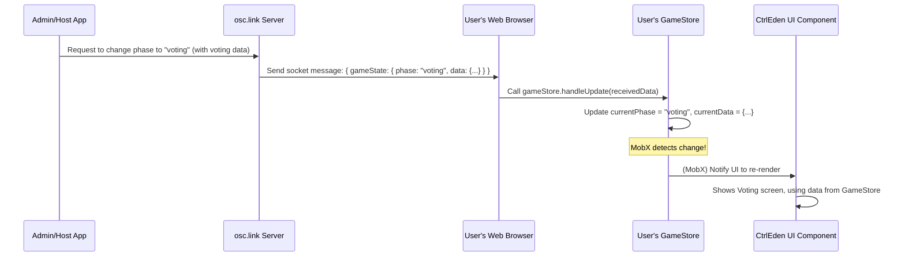

# Chapter 7: Game State Management (CtrlEden)

Welcome to the final chapter of our `osc.link` beginner's tutorial! In [Chapter 6: State Management (MobX Stores)](06_state_management__mobx_stores__.md), we learned how `osc.link` uses MobX stores to manage general application data and keep the UI in sync. Now, we're going to look at a more specific and advanced use of state management: how `osc.link` can run a whole interactive game with different stages, like "CtrlEden."

## What's the Big Idea? Running a Multi-Stage Interactive Game

Imagine you want to run an interactive game with your audience using `osc.link`. Maybe it's a game where:
1.  Everyone waits in a "lounge."
2.  The game starts, and players get a "prompt" to respond to.
3.  Everyone "votes" on the responses.
4.  Finally, the "results" and scores are shown.

How does `osc.link` keep track of which stage the game is in? How does it ensure everyone sees the right screen for "waiting," "playing," "voting," or "seeing results"? This is where **Game State Management** for an experience like **CtrlEden** comes in.

CtrlEden is an example of a structured, multi-phase interactive game built within `osc.link`. It's more complex than just sending simple button presses. It needs a way to:
*   Define the different stages (or "phases") of the game.
*   Know what the *current* phase is.
*   Store data relevant to the current phase (like questions for players, images to vote on, scores).
*   Update everyone's screen as the game moves from one phase to the next.

This is all managed primarily on the web client (the user's browser) using the `GameStore` we met briefly in the last chapter. The server (often controlled by an admin or the [Electron Host Application (OSC Bridge)](04_electron_host_application__osc_bridge__.md)) tells the clients when to change phases.

## Key Concepts for CtrlEden's Game State

1.  **Phases:** These are the distinct stages of the CtrlEden game.
    *   `lounge`: A waiting area before the game starts.
    *   `splash`: An introductory screen for the game.
    *   `announce_players`: Shows who is playing.
    *   `round_start`: The main gameplay phase where players might get a prompt or task.
    *   `round_end`: Indicates the gameplay part of the round is over.
    *   `voting`: Players (or the audience) vote on submissions.
    *   `results`: Shows the outcome of the voting.
    *   `points`: Displays scores or points awarded.
    *   `ui-update`: A special phase for sending minor UI changes without a full phase transition.

    The `gameStore.ts` file defines these phases:
    ```typescript
    // Simplified from: packages/web/src/stores/gameStore.ts
    export type Phase = 'lounge'|'splash'|'announce_players'|'round_start'| // ... more phases
                        'voting'|'results'|'points'|'ui-update';
    ```
    This `Phase` type lists all possible stages the game can be in.

2.  **Phase-Specific Data:** Each phase might need different information.
    *   `round_start` might need a text prompt (e.g., "Draw a cat on a rocket!").
    *   `voting` might need a list of images submitted by players.
    *   `results` might need player scores and winning entries.

    The `GameStore` is designed to hold this data. For example, `Phase3RoundData` might look like:
    ```typescript
    // Simplified from: packages/web/src/stores/gameStore.ts
    export type PromptItem = { id: number, prompt: string, hint?: string };
    export type Phase3RoundData = {
      timer: number; // How long this round lasts
      audience: { prompt_selection: PromptItem[] }; // Prompts for audience
    } & PromptItem; // The main prompt for players
    ```
    This tells us that for a `round_start` phase, we might have a timer, a main prompt, and prompts for the audience.

3.  **The `GameStore` (Your Game's Conductor):**
    As we saw in [Chapter 6: State Management (MobX Stores)](06_state_management__mobx_stores__.md), the `GameStore` (from `packages/web/src/stores/gameStore.ts`) is a MobX store. For CtrlEden, it's super important because it tracks:
    *   `currentPhase`: Which stage the game is currently in (e.g., `'voting'`).
    *   `currentData`: The specific data for the `currentPhase` (e.g., the list of images to vote on).
    *   Other relevant info like player lists (`players`, `audience`), specific round data (`roundData`), voting data (`votingData`), etc.

    When these MobX observable properties in the `GameStore` change, the UI automatically updates!

4.  **UI Reacts to `GameStore`:**
    The main UI component for CtrlEden (like `CtrlEden/index.tsx` in `packages/web/src/components/Controller/CtrlEden/index.tsx`) "listens" to the `GameStore`.
    *   If `gameStore.currentPhase` changes from `'lounge'` to `'round_start'`, the UI component will switch from showing the "Lounge" screen to showing the "Round Start" screen.
    *   The "Round Start" screen will then use data from `gameStore.roundData` (like the prompt) to display the correct information.

## How CtrlEden Flows: From Lounge to Results

Let's imagine a simplified flow of the CtrlEden game:

1.  **Game Starts (Server Initiates):** An admin (perhaps using the [Electron Host Application (OSC Bridge)](04_electron_host_application__osc_bridge__.md) or a special admin interface) decides to start a new phase of the game. For instance, moving from "lounge" to "round_start".
2.  **Server Sends Update:** The server sends a message (e.g., `OSC_HOST_MESSAGE`) via [Socket Communication (Real-time Interaction)](03_socket_communication__real_time_interaction__.md) to all connected web clients in that CtrlEden session. This message contains the new game state:
    ```json
    // Conceptual message from server
    {
      "gameState": {
        "phase": "round_start",
        "data": { /* ... data for the round_start phase ... */ }
      }
    }
    ```
3.  **Client Receives Update:** Each user's browser receives this message.
4.  **`GameStore` Updates:** The client-side socket handler calls an action in the `GameStore` (specifically, the `handleUpdate` method) with this new game state.
    ```typescript
    // Inside GameStore (packages/web/src/stores/gameStore.ts)
    // @action handleUpdate = (data: GameStateUpdatePayload) :void => {
    //   this.currentPhase = data.gameState.phase;
    //   this.currentData = data.gameState.data;
    //   // ... more logic to set specific data like roundData, votingData ...
    // }
    ```
    This action updates the `currentPhase` and `currentData` observables in the `GameStore`.
5.  **UI Changes Automatically:** Because `currentPhase` (and other relevant data) in `GameStore` is an observable, and the CtrlEden UI components are observing it (using MobX's `observer`), the UI automatically re-renders to show the correct screen for the new phase.

    For example, the main `CtrlEden` component might have logic like this:
    ```tsx
    // Simplified from packages/web/src/components/Controller/CtrlEden/index.tsx
    // const CtrlEden = observer(() => {
    //   const { gameStore } = useStores();
    //
    //   if (gameStore.currentPhase === 'lounge') {
    //     return <Lounge />;
    //   }
    //   if (gameStore.currentPhase === 'round_start') {
    //     return <Round />;
    //   }
    //   // ... and so on for other phases
    // });
    ```
    So, if `gameStore.currentPhase` becomes `'round_start'`, the `<Round />` component is shown.

6.  **Phase-Specific Components:** Each phase component (like `<Lounge />` from `CtrlEden/Phases/Lounge.tsx` or `<Round />` from `CtrlEden/Phases/Round.tsx`) then uses more detailed data from `GameStore` to display its content.
    *   The `<Round />` component might display `gameStore.roundData.prompt`.
    *   The `<Voting />` component might display images from `gameStore.votingData.results`.

This cycle repeats as the game moves through its different phases.

## Under the Hood: A Game Phase Change

Let's visualize how a phase change is communicated and processed:



**Diving into the Code (Simplified):**

1.  **`GameStore` Reacts to Server Messages (`gameStore.ts`)**

    The `GameStore` has observable properties to hold the current game state:
    ```typescript
    // Simplified from packages/web/src/stores/gameStore.ts
    import { observable, action, makeAutoObservable } from 'mobx';
    // ... other imports and type definitions ...

    export class GameStore {
      @observable currentPhase: Phase | null = null;
      @observable currentData: PhaseData | null = null; // Generic data for current phase
      @observable roundData: Phase3RoundData | null = null; // Specific data for round
      @observable votingData: Phase5VotingData | null = null; // Specific for voting

      constructor(/* ... */) { makeAutoObservable(this); /* ... */ }

      @action handleUpdate = (payload: GameStateUpdatePayload): void => {
        console.log('gameStore - handleUpdate', payload);
        this.currentPhase = payload.gameState.phase;
        this.currentData = payload.gameState.data; // Store the general data

        // Example: Set specific data based on phase
        if (this.currentPhase === 'round_start') {
          this.setRoundData(payload.gameState.data as Phase3RoundData);
        } else if (this.currentPhase === 'voting') {
          this.setVotingData(payload.gameState.data as Phase5VotingData);
        }
        // ... logic for other phases, and clearing old data ...
      };

      @action setRoundData = (data: Phase3RoundData | null): void => {
        this.roundData = data;
      }
      // ... other setters like setVotingData, setPlayers etc.
    }
    ```
    When `handleUpdate` is called (usually triggered by a message from the server via [Socket Communication (Real-time Interaction)](03_socket_communication__real_time_interaction__.md)), it updates `currentPhase` and `currentData`. It also intelligently populates more specific properties like `roundData` or `votingData` based on the new phase.

2.  **Main Game UI (`CtrlEden/index.tsx`) Switches Views**

    The main component for the CtrlEden game uses the `gameStore.currentPhase` to decide which sub-component (representing a game phase) to display.
    ```tsx
    // Simplified from packages/web/src/components/Controller/CtrlEden/index.tsx
    import React, { useEffect, useState } from 'react';
    import { observer } from 'mobx-react-lite';
    import { useStores } from '../../../hooks/useStores';
    import Lounge from './Phases/Lounge';
    import Round from './Phases/Round';
    import Voting from './Phases/Voting';
    // ... other phase imports

    const CtrlEden = (/* ... props ... */) => {
      const { gameStore } = useStores();
      // States to control visibility of phase components
      const [showLounge, setShowLounge] = useState(true);
      const [showRoundStart, setShowRoundStart] = useState(false);
      // ... other showX states for each phase

      useEffect(() => {
        // This effect runs whenever gameStore.currentPhase changes
        console.log('CtrlEden - currentPhase changed to:', gameStore.currentPhase);
        setShowLounge(gameStore.currentPhase === 'lounge');
        setShowRoundStart(gameStore.currentPhase === 'round_start');
        // ... set other showX states based on gameStore.currentPhase ...
        setShowVoting(gameStore.currentPhase === 'voting');
      }, [gameStore.currentPhase]); // Dependency: re-run if currentPhase changes

      return (
        <div /* ... styles ... */>
          {/* Conditionally render phase components based on their 'showX' state */}
          {showLounge && <Lounge />}
          {showRoundStart && <Round />}
          {showVoting && <Voting firedMouseUp={props.firedMouseUp} />}
          {/* ... other phases ... */}
        </div>
      );
    };

    export default observer(CtrlEden); // Make component reactive to gameStore changes
    ```
    The `useEffect` hook here is crucial. It listens for changes in `gameStore.currentPhase`. When `currentPhase` changes, the `useEffect` updates various `show...` state variables, which in turn causes the correct phase component (like `<Lounge/>` or `<Round/>`) to be rendered.

3.  **A Phase-Specific Component (`CtrlEden/Phases/Voting.tsx`)**

    Let's look at a very simplified `Voting` component. It would use `gameStore.votingData` to display items for voting.
    ```tsx
    // Simplified from packages/web/src/components/Controller/CtrlEden/Phases/Voting.tsx
    import React from 'react';
    import { useStores } from '../../../../hooks/useStores';
    import { observer } from 'mobx-react-lite';
    // ... other imports ...

    const Voting = (/* ... */) => {
      const { gameStore } = useStores();
      // gameStore.votingData contains { timer, results: [{player_index, image}, ...] }

      return (
        <div>
          <h2>Vote for your favorite!</h2>
          <p>Time left: {gameStore.votingData?.timer}s</p>
          <div>
            {gameStore.votingData?.results.map((item, index) => (
              <div key={index}>
                
                {/* Add a button here to vote for item.player_index */}
              </div>
            ))}
          </div>
        </div>
      );
    };
    export default observer(Voting);
    ```
    This `Voting` component directly accesses `gameStore.votingData` (which was populated by `GameStore.handleUpdate`) to get the timer and the list of images to display for voting. Because it's an `observer`, if `gameStore.votingData` changes (e.g., a new image is added, or the timer updates), this component would re-render.

## Conclusion: Orchestrating Complex Interactions

**Game State Management**, as demonstrated by the CtrlEden example, shows how `osc.link` can go beyond simple controls to manage sophisticated, multi-stage interactive experiences. By using the `GameStore` (a [MobX Store](06_state_management__mobx_stores__.md)) to track the current game phase and its associated data, `osc.link` ensures that all participants see the correct UI and information at the right time.

The server dictates the flow by sending game state updates, and the client's `GameStore` translates these updates into changes that the UI components (like `CtrlEden/index.tsx` and its phase-specific children) react to automatically. This allows for creating rich, turn-based games and structured interactions with your audience.

This concludes our journey through the core concepts of `osc.link`! We've covered everything from defining an [Instance (Session Configuration)](01_instance__session_configuration__.md) and the [Controls (User Input Elements)](02_controls__user_input_elements__.md) users interact with, to how [Socket Communication (Real-time Interaction)](03_socket_communication__real_time_interaction__.md) and the [Electron Host Application (OSC Bridge)](04_electron_host_application__osc_bridge__.md) enable real-time control, and how the server manages sessions ([Server-Side Instance & Slot Management](05_server_side_instance___slot_management_.md)). Finally, we've seen how client-side [State Management (MobX Stores)](06_state_management__mobx_stores__.md) and today's topic, Game State Management, bring dynamic and complex interactions to life.

We hope this tutorial has given you a friendly introduction to the building blocks of `osc.link`. Happy creating!

---

Generated by [AI Codebase Knowledge Builder](https://github.com/The-Pocket/Tutorial-Codebase-Knowledge)