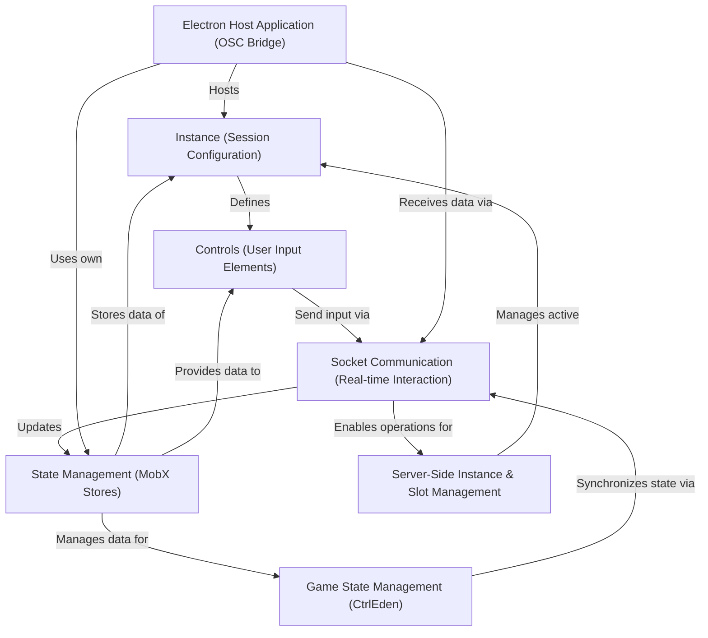

# Tutorial: osc.link

**osc.link** is a platform enabling *real-time interaction* between multiple users on web browsers (e.g., mobile phones) and applications supporting the **OSC (Open Sound Control) protocol**.
Users join a specific *session*, known as an **Instance**, which defines available **Controls** (like buttons or XY pads).
User interactions are sent via **Socket Communication** to a server and then to a local **Electron host application**.
This Electron app acts as a *bridge*, translating web inputs into OSC messages for software like DAWs or media servers.
The project also supports complex, multi-stage interactions like the **CtrlEden game**.

**Source Repository:** [None](None)

## Chapters

1. [Instance (Session Configuration)
](01_instance__session_configuration__.md)
2. [Controls (User Input Elements)
](02_controls__user_input_elements__.md)
3. [Socket Communication (Real-time Interaction)
](03_socket_communication__real_time_interaction__.md)
4. [Electron Host Application (OSC Bridge)
](04_electron_host_application__osc_bridge__.md)
5. [Server-Side Instance & Slot Management
](05_server_side_instance___slot_management_.md)
6. [State Management (MobX Stores)
](06_state_management__mobx_stores__.md)
7. [Game State Management (CtrlEden)
](07_game_state_management__ctrleden__.md)

---

Generated by [AI Codebase Knowledge Builder](https://github.com/The-Pocket/Tutorial-Codebase-Knowledge)